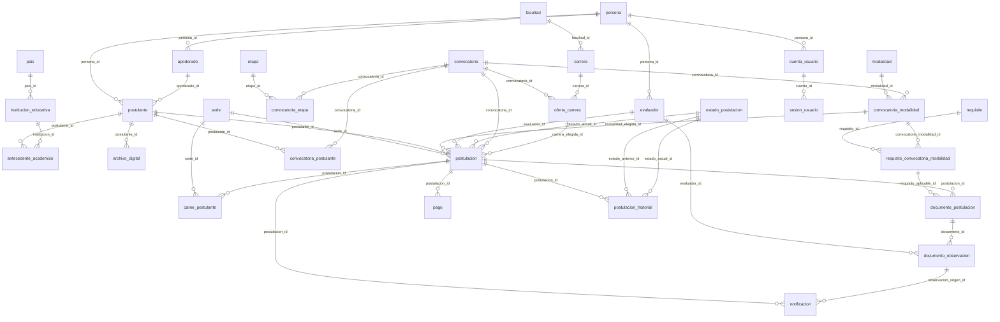

# Diagrama de relaciones de la base de pruebas LAB12

Obtenido de information_schema de admitu_db después de las migraciones; no contiene datos ni credenciales. Las asociaciones muestran la clave foránea; las restricciones de estados y unicidad están en los procedimientos y migraciones.

Las entidades nuevas son archivo_digital, cuenta_usuario y sesion_usuario. Postulacion incorpora sede_id y evaluador_id. Los índices uq_postulante_convocatoria y uq_pago_vigente protegen las operaciones concurrentes.
