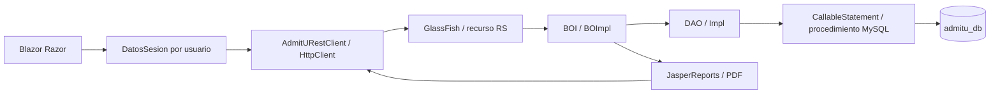

# Guía de sustentación y uso de IA

## Explicar el flujo completo

C# consume JSON y PDF; no abre conexiones MySQL. El recurso REST conserva las rutas por acción y delega al BO. El BO aplica reglas y confirma o revierte operaciones compuestas. El DAO utiliza CallableStatement y los procedimientos mantienen restricciones e integridad. Los seis módulos Maven y las clases de dominio se conservan.

## Demostraciones que debe dominar el equipo

1. **Convocatorias y catálogos.** Crear, consultar, editar, dar de baja y reactivar; cancelar una confirmación no cambia la base. La reactivación invoca REACTIVAR_*; modificar metadata no basta para restaurar activo.
2. **Postulación.** Mostrar el formulario y el JSON compuesto. La clave única es postulante/convocatoria, sin carrera. El busy evita doble clic en la experiencia; la garantía ante dos solicitudes está en BO/transacción/BD. Al fallar un documento obligatorio no quedan expediente, pago ni historial parcial.
3. **Archivos.** Mostrar bytes reales, límites y validación de tipo/firma, SHA-256 y descarga. Una ruta o un nombre no constituyen almacenamiento. Los bytes se recuperan de MySQL y los recursos comprueban rol/propietario.
4. **Pagos y estados.** El importe procede de convocatoria/modalidad. Adjuntar un voucher reutiliza el pago generado. La aprobación exige archivo, fija la fecha y queda protegida. El historial se registra en la misma transacción SQL.
5. **Carné.** La emisión exige expediente apto/documentos válidos/pago aprobado y finaliza la inscripción atómicamente. La anulación conserva fila, código y titular mediante el marcador compatible con la UI.
6. **Jasper.** Abrir los JRXML propios, explicar los SP y los filtros, generar el PDF y comparar sus totales con SQL. FINALIZADA es el código real para inscripción completada. No sumar varias veces un cupo de carrera compartido por modalidades.
7. **Seguridad.** Contraseña salada y derivada con PBKDF2, token opaco cuyo hash se persiste, cookie HttpOnly/SameSite, antiforgery, roles y ownership backend. Repetir un intento de autoaprobar un pago y mostrar el 403 sin exhibir tokens.
8. **Límites.** Compilar, probar una API y completar un flujo visual son evidencias distintas. Quinientas lecturas públicas no acreditan quinientos trámites. No afirmar despliegue remoto sin prueba en la infraestructura real.

## Responsabilidades y registro de IA

Diego RF01–03; Harold RF04–06; Richard RF07–09; Francis RF10–12; Matías RF13–15. Los cambios en sesiones, autenticación, archivos, SQL y transacciones son transversales y deben revisarse por todo el equipo antes de integrar el PR.

Se utilizó Codex para inspección, implementación, pruebas y documentación a partir del encargo entregado por el responsable el 12/11/2026. Los commits de `codex/lab12-completo` constituyen el registro de cambios; la matriz y los resultados describen qué se ejecutó realmente. Cada integrante debe revisar y comprender sus RF y adaptar la declaración de IA al formato que solicite el docente.

El prompt autoriza conservar el stack del curso, resolver ocho observaciones, completar archivos y tres reportes Jasper, mejorar seguridad y atomicidad, probar y abrir PR a lab11-diego sin merge. El ZIP del profesor se utilizó privadamente para contrastar BOI/BO, DAO/CallableStatement, TransactionContext, recursos REST, HttpClient y Jasper. No se incluyen sus fuentes, ZIP, configuraciones ni credenciales. La [metodología documentada](../../METODOLOGIA_PROFESOR.md) distingue convenciones docentes y correcciones de ingeniería necesarias.

Para la revisión, seguir la [matriz RF](matriz-rf.md), las [evidencias](evidencias.md), el [diagrama BD](diagrama-bd.md), las [incidencias](incidencias.md) y el [procedimiento de despliegue](../despliegue/README.md).
